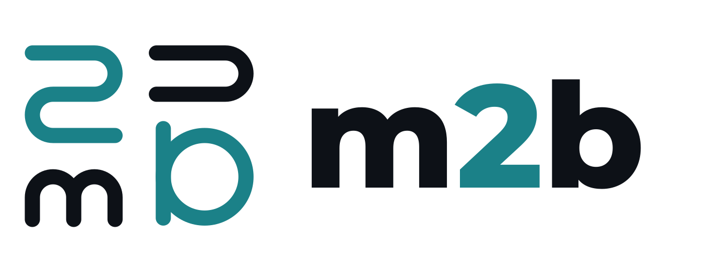
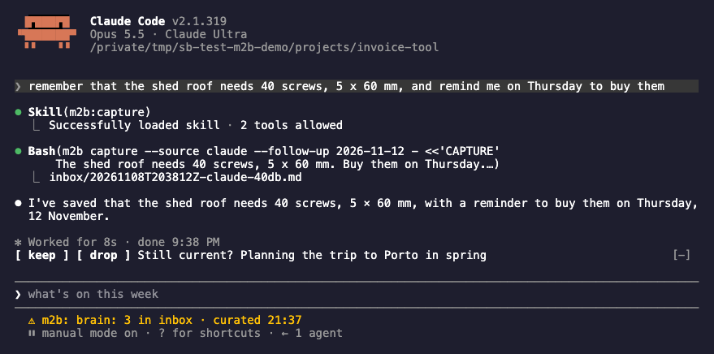
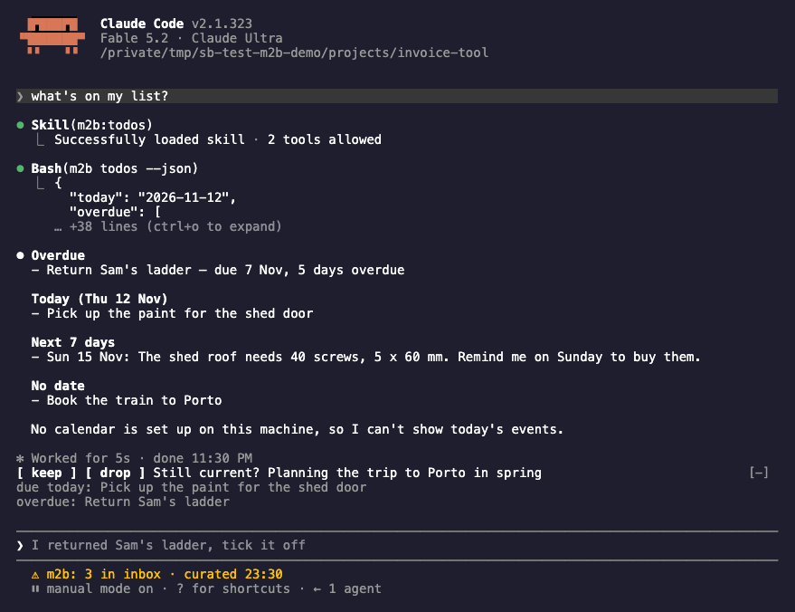

<p align="center">
  <picture>
    <source media="(prefers-color-scheme: dark)" srcset="docs/images/logo-dark.png">
    
  </picture>
</p>

<p align="center"><em>A second brain for Claude Code. The right context in every session.</em></p>

<p align="center">
  <a href="https://github.com/Kolibee-GmbH/m2b/releases"></a>
  <a href="LICENSE"></a>
  
  
</p>

<p align="center">
  <a href="#install"><strong>Install</strong></a> ·
  <a href="#features">Features</a> ·
  <a href="#add-ons">Add-ons</a> ·
  <a href="#configure">Configure</a> ·
  <a href="docs/getting-started.md">Getting started</a> ·
  <a href="CHANGELOG.md">Changelog</a>
</p>

## TL;DR

- You capture notes, facts and tasks from any Claude Code session or the command line. Nothing
  is filed while you work: captures land in an inbox, written once and never edited.
- At the next session start after a capture, a curation run files the inbox in the background:
  facts into a small distillate, tasks into your task list, every capture into an archive by
  month. Every new session starts with the distillate.
- Your notes are plain Markdown files in a folder you choose: iCloud Drive, a synced folder, or
  any local folder. Tasks live in Apple Reminders or in Markdown files next to the notes.
- The model files your notes in a separate `claude -p` run that may call only the commands its
  step needs, never in your session. Everything else is plain code: standard library Python, no
  network calls of its own, no server, no database.


<sub>A new session in an unrelated repository already knows. The band above the prompt and the
status line below it are [the band](docs/band.md), where m2b asks you to keep or drop; Claude Code
draws the ⚠ in front of every plugin's status line, it is not a warning. All names and notes are
invented.</sub>

**Platform.** macOS 14 or newer, or Linux. Not Windows. Apple Reminders, Calendar and iCloud Drive
are optional; on Linux, and on a Mac if you like, the store is a plain folder and tasks are
Markdown files.

**Cost.** A curation run uses your Claude Code login, with Haiku by default. Measured on
2026-11-08 with Claude Code 2.1.319: a run over five captures took 48 seconds and 31 turns,
read about 365,000 input tokens (338,000 of them from Claude Code's prompt cache) and wrote 8,000;
Claude Code put it at US$0.013 at API prices. A run with nothing to read (an empty inbox, nothing
expiring, no memory link to repair) uses no model.

## Words used here

| Word | Meaning |
|---|---|
| store | the folder that holds your notes: `inbox/`, `corpus/` (the archive), `memory/` |
| capture | one note as you said it, one file in `inbox/` |
| curation run | the background run that files the inbox, on one machine per store, the curating machine |
| distillate | `memory/MEMORY.md`: lasting facts, each pointing to its fact file in `memory/`, and under "Current" what is going on now |
| topic | a heading in the distillate for one subject, such as a customer or a club, whose facts come in only when a session is about it |
| band | the rows above the prompt where you keep or drop what curation proposes, and the status line below it |
| add-on | an optional piece of m2b, off until its own setup: `worklog` |

## Who it is for

You work in Claude Code on more than one project and want what you learn about people,
agreements and your own life to outlast a session and a repository. A project's own decisions
belong in its repository and its `CLAUDE.md`; m2b is for what has no repository.

| | Holds | Where it lives | Who writes it |
|---|---|---|---|
| `CLAUDE.md` | instructions and facts for one project | in the repository | you, by hand |
| Claude Code's memory | short notes Claude keeps for itself | Claude Code's own files, per project or user | Claude, in the session |
| A notes MCP server | whatever the server stores | the server | the model, in the session |
| m2b | your notes, facts and tasks across all projects, as plain files you own | a folder you choose, synced as you like | you capture; a curation run files |

### m2b or Claude Code's auto memory

Claude Code keeps its own memory: short notes it writes for itself during a session, in files
under `~/.claude` for each project. It stays on beside m2b, and a first "remember this" may land
in either. The rule every session gets with the distillate keeps them apart: how Claude should
work stays with Claude Code, in its memory or in a `CLAUDE.md`; what concerns your life and world
across projects goes to m2b.

What m2b has that Claude Code's memory does not:

- your words kept as you said them, in the archive, with every fact pointing back to them;
- facts that end on a known day (`until`) and are rewritten once it has passed;
- tasks, in Apple Reminders or Markdown files, from the same "remind me";
- filing in a separate run, so your session never spends turns on it;
- topics, so a customer's facts reach only the sessions about that customer;
- one store across all projects and machines, in a folder you choose and sync as you like, as
  plain Markdown you can read, back up and move without m2b.

## Install

```
/plugin marketplace add Kolibee-GmbH/m2b
```

```
/plugin install m2b@m2b
```

Install it for your user, the default; installed for one project only, nothing outside Claude
Code finds it. Then, in a Claude Code session:

```
/m2b:m2b setup
```

`setup` walks through the core and then offers each add-on, saying before each step what
it does. The quickest way is the first one it offers: a new folder `~/m2b` with tasks as Markdown
files, nothing else to install. It never overwrites a store that exists: pointed at a folder
another machine already uses, it joins it. [Getting started](docs/getting-started.md) walks
through it, including a first run without Claude Code.

Setup writes the command `~/.local/bin/m2b` for terminals and schedules. `~/.local/bin` is not on
the `PATH` by default on macOS; add it, for example in `~/.zshrc`:

```bash
export PATH="$HOME/.local/bin:$PATH"
```

**Requirements:** Claude Code 2.1.319 or newer, logged in, and Python 3.9 or newer as `python3`.
On a fresh Mac, `python3` comes with the Command Line Tools: `xcode-select --install`. For Apple
Reminders: [`reminders-cli`](https://github.com/keith/reminders-cli)
(`brew install keith/formulae/reminders-cli`).

### Updating

```
/plugin marketplace update m2b
```

```
/plugin update m2b@m2b
```

Then restart Claude Code. An update arrives only with a new version number: while the
installed version matches the marketplace's, `/plugin update` reports it as the latest, even if
the repository has newer commits. What each version changed is in the [changelog](CHANGELOG.md).
Your store, config and setup stay as they are. When a version changes a rule for what the store
holds, the curating machine's next run migrates the store by itself; update that machine first
([Several machines](docs/several-machines.md#machines-on-different-versions)).

### Uninstalling

1. Turn the add-ons off that left something outside Claude Code: with the worklog on, run
   `/m2b:worklog-setup remove` in a session, which turns it off and unlinks its herdr recorder;
   and delete any schedule you set up for `m2b curate` (a Shortcuts automation or a cron line).
2. Uninstall the plugin in `/plugin`. That stops every hook, the band and the recorder.
3. Delete what m2b keeps on the machine, if you want it gone:

   ```bash
   rm -rf ~/.local/bin/m2b ~/.config/m2b ~/.local/state/m2b ~/.local/share/m2b
   ```

Your store stays as it is: plain files, yours to keep or delete. So do the tasks m2b created in
your list, such as a review task or a "Remember? ..." candidate.

## Features

### Capture

In any session, say what you want kept: "remember that Dana's birthday is on 3 March", "note
this", "remind me to call the plumber on Friday". You type no command: the `capture` skill writes
one file into `inbox/` with your words verbatim, and with a date it also creates a task that
points back to the note. Say that you want it kept; a sentence on its own, such as "Dana's
birthday is on 3 March", stays part of the conversation and is not captured.

With Apple Calendar set up, "put it in my calendar" creates an event in the calendar you name,
never in a default one. Calendar entries are experimental.



From a terminal or a script, without a Claude session, the same goes through the command:

```bash
m2b capture "Dana's birthday is on 3 March"
m2b capture --follow-up 2026-11-20 "Call the plumber about the shed"
```

### The distillate at session start

A session-start hook prints the distillate, at most 8 KB: lasting facts, each pointing to its
fact file, and what is going on right now. Facts that matter only for one subject sit under a
topic; a session sees the topic's name, and its facts come in when a prompt or the project
folder's path names it. The hook also prints one line when something needs you: the last
curation run failed, the curating machine has not run for three days, or the store cannot be
found. The distillate is marked as data from your notes, not instructions. In a project where it
should not appear, such as a screen share or a customer's repository, `m2b distillate off` in
that folder turns it off for every session there and below, on this machine.

Sessions capture what you learn about people and verbal agreements, at work too: who is who,
which role, what was agreed. Documents of customers and what a third party told you in confidence
are never captured. A customer's people land under that customer's topic, so their facts reach a
session only when it is about that customer. Lines under Current reach every session.

### Search, todos, rediscover

"What did I note about the shed?", "what's open?", "show me something old": the `search`,
`todos` and `rediscover` skills answer from the store. Search is full text over archive, memory
and inbox; the skill searches a word together with its translation, so a note written in German
answers a question asked in English. Todos lists overdue, this week and undated tasks, and today's events when a calendar
is set up. Rediscover brings one or a few old notes back, each with its reason, also for "what
did I note last spring?". A file iCloud Drive has not downloaded is named, never read and never
counted as missing.



### The curation run

It starts by itself at session start on the curating machine when a capture waits in the inbox
or the last successful run is more than 20 hours old. A schedule is optional; it helps when captures arrive
while the curating machine has no session for days ([On a schedule](docs/curation.md#on-a-schedule)).
The model reads only when there is something to read: new captures, or a fact past the day it
was true until, such as an appointment. A step that fails is reported and the run goes on; the
review task in your list says what needs you. [The curation run](docs/curation.md) lists its
steps, the one-off runs for a distillate moved over from another tool, and the status line.

### Memory candidates

A line under Current that no capture has touched for a month comes back as a task "Still
current? ...": tick it and it stays; drop it in the band, or delete the task, and it leaves the
distillate. The worklog add-on may propose a fact the same way, as "Remember? ...": tick it and the
next run files it; drop it in the band, or delete the task, and it does not come back for 90 days.

## The band

Above the prompt, [the band](docs/band.md) shows memory candidates and "Still current?" questions,
each with keep and drop buttons you click with the mouse (a click waits 5 seconds with `undo`
before it writes), and the open review task with its first findings; below the prompt, a status
line such as `3 in inbox · curated 18:02`. `/m2b-note <text>` notes a text into the inbox at once,
without a model turn, also while one is working. `/m2b-review` opens a pane with the whole last
curation run, and `/m2b-search <text>` shows search hits there. The model notes and searches
through two tools of the mod, `mcp__m2b__note` and `mcp__m2b__search`, without a shell call. The
band is part of m2b and starts once m2b is set up. It is a mod, so it needs mods on in Claude Code; `m2b doctor` says
whether the latest session ran it, and why not.

## Add-ons

m2b is one plugin. One add-on in it is off until you set it up with its own setup skill, and
`m2b addons list` shows whether it is on.

| Add-on | What it adds | Needs | Setup |
|---|---|---|---|
| [`worklog`](docs/addons/worklog.md) | A daily worklog of your sessions in herdr: topics, time spans per sphere of work, booking proposals for billable spheres, a ledger with CSV and XLSX exports | [herdr](https://herdr.dev) 0.9 or later, running; the curating machine, which alone records; your spheres of work and customers, which its setup asks for | `/m2b:worklog-setup` |

Its page, linked in the table, says what it reads and writes on the machine and in the store, its
commands, and how you see that it runs. [Add-ons](docs/addons.md) is the overview. To turn it off
again, keeping its settings:

```bash
m2b addons off worklog
```

## Cost and privacy

**The model.** Only a curation run calls a model, and only for a step with something to read:
ingest for new captures, refresh for a fact past its day, lint for a broken link in memory with
exactly one candidate, and the worklog's verdict once a day while that add-on is on, unless the day
had no sessions. Each step runs with `curation.model` (`haiku` by default; setup offers `sonnet`
for more careful filing at a higher cost) and stops after `curation.max_turns` turns;
`curation.max_budget_usd`, unset by default, caps its spending. It runs on your Claude Code login
and is billed like your sessions.

**What reaches the model.** In a curation step: what the step's rules allow, nothing else. Ingest
and lint read the captures and memory files; refresh reads the distillate, the fact files that are
due and any archive file; sorting reads memory. Ingest, lint, `--refresh-all` and the worklog step
also get `m2b search` results over inbox, archive and memory. With the worklog add-on, its step sees
the period's prompts and last answers, commits and session folders, the inbox, memory and your task list (below). In every session:
the distillate, the routing rule and the notices at session start; before a prompt that names a
topic, that topic's facts.

**What the worklog reads** (only while on, only on the curating machine): the herdr events its
recorder writes to `~/.local/state/m2b/worklog/`, the prompts and the end of each session's last
answer from your Claude Code transcripts for the period (with credentials and long tokens
redacted), your own git commits, and the inbox; its model step may also search the archive. Its
ledger with time spans and booking proposals lands in the store under `state/addons/worklog/`.
A time span is when a workspace was in use: an agent at work (up to 30 minutes past its last sign
of life, so a machine asleep does not count), the workspace in focus (up to 10 minutes after each of
its own events, because herdr cannot tell typing from looking), or messages in its transcript at most
15 minutes apart, merged across gaps of up to 15 minutes; waiting for an approval does not count.
The same minutes count once, also when a workspace is closed and opened again. An agent left working
on its own, a loop through the night for one, counts as well, so check a booking proposal before you
enter it. A stretch the recorder did not record, because herdr was not running or the machine slept,
is named in the note as not recorded, never read as a time without work. The
[worklog page](docs/addons/worklog.md#time-spans) has the rules.

## Configure

Three files, each with one owner:

| File | Where | Holds |
|---|---|---|
| `config.json` | `~/.config/m2b/` on each machine | the store's folder and backend, the calendar, absolute paths of `python3`, `claude`, `reminders` and `osascript`, which add-ons are on and their settings |
| `store.json` | the store | the store format, the task backend, which machine curates |
| `profile.json` | the store | your name and language (`en` or `de`, for the task titles and notes m2b writes), and for the worklog your spheres and customers |

Change them through commands, which check each value and write the file whole, so a sync client
never picks up half a file:

```bash
m2b config set curation.model sonnet
m2b profile set language de
```

[Configuration](docs/configuration.md) lists every key. [Store format](docs/store-format.md)
describes the folder, the file names and the frontmatter. [Several machines](docs/several-machines.md)
covers joining a store from a second Mac and moving curation.

## Troubleshooting

```bash
m2b doctor
m2b status
```

`doctor` checks every backend and says what to fix; `status` shows the inbox, the last run and
whether a run is due.

- **`m2b: command not found`.** Add `~/.local/bin` to your `PATH` (see Install). Inside a
  session, `!m2b status` works without it.
- **No `python3`, or a message that m2b needs Python 3.9.** On a Mac run
  `xcode-select --install`; on Linux install `python3` from your distribution.
- **`m2b: the core plugin m2b@m2b is not installed for this user`, or `doctor` reports
  `claude-code: missing`.** m2b is not installed for your user: for one project only, or not at
  all. Remove a project install in `/plugin`, then install it for your user (see Install).
- **A step fails with a login message, or `claude` is not found.** Run `claude` in a terminal and
  log in. A schedule runs with a short `PATH`; record where `claude` is:
  `m2b config set executables.claude "$(command -v claude)"`.
- **The session start says the last run failed.** The review task in your list names the step
  and the cause. Fix it and run `m2b curate --force`.
- **`curating` for a long time.** A run is going on; each model step is stopped after
  `curation.model_timeout_minutes` (15). When it ends, its outcome is added to
  `~/.local/state/m2b/run.log`.
- **Tasks "not reachable" with Apple Reminders.** The terminal Claude Code runs in needs access:
  System Settings, Privacy & Security, Reminders.
- **"not set up".** Run `/m2b:m2b setup` on this machine.
- **Files "not downloaded".** iCloud Drive keeps them in the cloud ("Optimize Mac Storage").
  `m2b store fetch <path>` downloads them; m2b never reads them by accident.

## Limits

- One owner per store. No sharing, no multi-user store.
- Full text search only, no semantic search: a note is found by the words it holds, or their
  translation.
- macOS and Linux. Windows is not supported: m2b relies on `fcntl` locks, process groups and
  `sh` scripts.
- The task titles, notes and worklog m2b writes are in English or German; everything else it
  prints is in English. Your notes can be in any language.
- On Linux there is no calendar backend, and a schedule is a cron line instead of a Shortcut.
- The worklog needs [herdr](https://herdr.dev) 0.9 or later and records only the curating machine. It never books anything: its
  bookings are proposals for you to enter.
- Sync is whatever moves the folder. m2b has no sync and no server of its own.
- Nothing captured is deleted automatically. What does get deleted: conflict copies identical
  to their original, the product's own leftover temp files and settled candidate tasks.

## Develop

```bash
scripts/check --quick m2b   # unit tests of the core (or worklog, band)
scripts/check               # everything, must end with "check: passed"
scripts/e2e --level stub    # end-to-end scenarios without a model
```

[Architecture](docs/architecture.md) is the short tour of the code; [CONTRIBUTING.md](CONTRIBUTING.md)
has the ground rules. To write your own client, read [Integrations](docs/integrations.md); to add a store,
task or calendar backend, [Writing a backend](docs/writing-a-backend.md). What m2b promises to do,
and which defects it must not have, is listed in [Behavior](docs/behavior.md).

## License

MIT, see [LICENSE](LICENSE). Security reports: [SECURITY.md](SECURITY.md).
