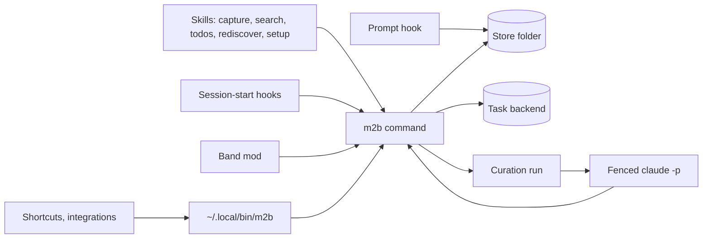

# Architecture

m2b is one Claude Code plugin, `plugins/m2b`. Everything the core does goes through one command,
`m2b`, which skills, hooks, the curation run and outside callers all use; the add-ons have
their own commands beside it (the worklog's `m2b-worklog`) and reach the core only
through `m2b`; of the core's code the worklog imports six modules that import nothing else of the
core: `redaction` and `claude_code`, so that the patterns that find credentials and the list of what
Claude Code writes into a prompt exist once, and `atomic_file` and `store.guard`, so that how a file
is written whole into a synced folder and how an evicted file is told exist once as well, and `session_remotes` and `git_program`, so that which remotes a folder's repository has and which git starts without asking the person anything do too. The other exception is the prompt hook, which runs before every prompt and therefore reads the distillate through its own slim
command instead of loading every command; it never writes to the store. The model never touches the store except
through a fenced run that may call only the commands its step lists.

The core needs no add-on. Every `scripts/check` proves it: the core's unit tests, and the end-to-end
scenarios that turn no add-on on, run in a copy of the plugin without the add-on's parts.

## Where things are

| Folder | What it holds |
|---|---|
| `plugins/m2b/src/m2b/` | the core: `cli.py` (every command), `store/`, `tasks/`, `calendar/` (backends behind one interface each), `config/` (`config.json`, `store.json`, `profile.json`), `curate/` (the run, the fenced model step in its two forms, a skill with its rules or a text to read with nothing to call, the run record, the commit of a run in a store that is a git repository), `sessions.py` (what the person typed, from Claude Code's transcripts), `redaction.py` (credentials out of such text), `glean.py` with `glean_instruction.md` (what a model is asked to propose for the memory from typed prompts, the form of its answer, and the checks code runs on it), `curate/glean_step.py` (the run's step that reads a period's sessions and asks, only while `curation.read_sessions` is on), `proposals.py` (what was proposed, in `state/core/proposals.json`), `proposal_answers.py` (keep and drop, one added file each) with `commands/proposals.py` (`m2b proposals`), `proposals_task.py` (the one task in the task list while proposals wait), `harvest.py` (the run's first step, which settles candidates and answered proposals into captures), `hooks.py` (session start), `prompt_hook.py` (before every prompt, with its own command `bin/m2b-prompt-hook` so it does not load every command), `addons.py` (the add-ons and their steps) |
| `plugins/m2b/src/m2b_worklog/` | the worklog add-on; it calls the core only through the `m2b` command, as an integration would, and imports its `redaction`, `claude_code`, `atomic_file`, `store.guard`, `session_remotes` and `git_program` |
| `plugins/m2b/skills/` | one folder per skill; the ones a curation run starts (`ingest`, `refresh`, `sort-facts`, `lint`, `worklog-verdict`) say so in their description |
| `plugins/m2b/hooks/` | `hooks.json` (session-start commands, the prompt hook and the band mod), `register.tsx` and its helpers (the band) |
| `plugins/m2b/recorder/` | the worklog's herdr recorder, copied out of the plugin when set up |
| `plugins/m2b/tests/` | core tests, with `tests/band/` the band's; `tests/addons/<add-on>/` the add-ons', which also hold what an add-on has to keep of the core's rules, so that the core's tests read no file of an add-on |
| `tests/e2e/` | end-to-end scenarios against a temporary store |
| `tests/glean/` | an invented day of typed prompts, which `scripts/glean-eval` asks a model about |
| `tests/ingest/` | an invented store and inbox, which `scripts/ingest-eval` has a model file in a real curation run |
| `tests/fence/` | the skill `scripts/fence-probe` starts as a curation step: the calls a step must not be able to make |
| `scripts/` | `check` (the whole proof), `e2e`, `trigger-check`, `glean-eval`, `ingest-eval`, `fence-probe`, `no-model`, `readme-images`, `readme-demo`, `evals-page`; `repo_tools/core_alone.py` lists what in the plugin's folder belongs to each add-on and runs the core without it |

## Three rules the code keeps

1. **Clients only add.** Skills, a Shortcut you write and integrations write new files into `inbox/`
   and new tasks; the todos skill ticks a task you say is done, and the band only ticks or drops a
   curator task. Only the curation run moves, renames or edits, and only on the machine
   `store.json` names.
2. **"Could not look" is never "nothing there".** Every answer that depends on a backend says
   when it could not reach it; an evicted iCloud file is named, never read, never counted as
   missing.
3. **The model is fenced.** A model step runs `claude -p` from an empty folder with
   `--setting-sources project`, this plugin alone, `--permission-mode dontAsk`, the step's rules,
   only the tools those rules name, no MCP server, no `CLAUDE.md`, no transcript, Claude Code's
   own folder denied,
   `curation.model` and `curation.max_turns`. A denied call fails the step and reaches the review,
   and a session that Claude Code starts with more tools than the step's is stopped at once.
   A step that only reads a text and answers gets no plugin and no tool at all, and one turn.
   What a step did to `memory/` is compared in code with a snapshot from just before it
   (`curate/memory_guard.py`): refresh is held to its due facts, ingest and lint have the facts
   lines they removed or rewrote listed in the review.

## What it relies on in Claude Code

Documented features: plugins, skills, command hooks, `CLAUDE_PLUGIN_ROOT`, `bin/` on the Bash
`PATH`, headless `claude -p`. Beyond them, `plugins/m2b/src/m2b/claude_code.py` lists the internals
(`installed_plugins.json`, `enabledPlugins`, transcript files, the mod API) and what breaks when
each changes; `m2b doctor` checks the one the launcher needs.

## Where the reasons are

[Behavior](behavior.md) lists what m2b promises (B IDs) and the defects it must not have (X IDs);
the tests name the IDs they pin. Why a module works the way it does stands in its docstring, next
to the code it explains.
