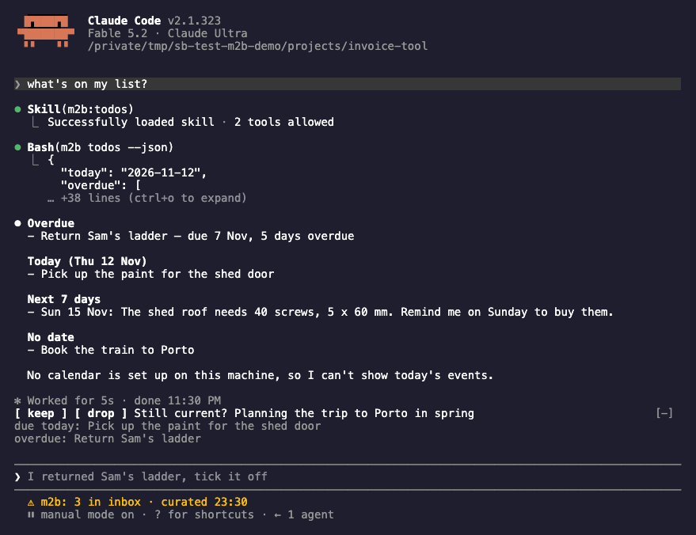

# Using m2b

What you can say in a session and what happens then, in detail. The [README](../README.md) has
the short table; [Commands](commands.md) lists every command for a terminal or a script, and
[The curation run](curation.md) every step of a run.

## Capture

In any session, say what you want kept: "remember that Dana's birthday is on 3 March", "note
this", "remind me to call the plumber on Friday". You type no command: the model's note tool,
or the `capture` skill where the band does not run, writes a note into `inbox/` in your own words,
without the request around them ("remember that", "remind me to"). With a date it also creates a
task that points back to the note, and the day stands in the task. Typed in a terminal, `m2b capture "<text>"` keeps the text character for character.
Say that you want it
kept; a sentence on its own, such as "Dana's birthday is on 3 March", stays part of the
conversation and is not captured.

A reminder and a to-do are the same thing in m2b: a task in your task list, Apple Reminders or
Markdown files in the store. Its due date is a day, without a time of day; whether your phone
alerts for it is up to the Reminders app.

"Put it in my calendar" creates an event in the calendar you name, never in a default one: a
title, a start and an end, or a whole day. It goes through the `capture` skill, not the note tool.
It needs macOS, `calendar.backend` set to `apple-calendar` on that machine (setup asks), and full
access to calendars for the terminal Claude Code runs in (System Settings, Privacy & Security,
Calendars); `m2b calendar list --writable` names the calendars it can write. A Google or Exchange
calendar works when Apple Calendar shows it. Calendar entries are experimental: a small extra
beside a notes product, kept apart from what m2b promises, not a sign of known faults.


From a terminal or a script, without a Claude session, the same goes through the command:

```bash
m2b capture "Dana's birthday is on 3 March"
m2b capture --follow-up 2026-11-20 "Call the plumber about the shed"
```

## The distillate at session start

A session-start hook prints the distillate, at most 8 KB: lasting facts, each pointing to its
fact file, and what is going on right now. Facts that matter only for one subject sit under a
topic; a session sees the topic's name, and its facts come in when a prompt or the project
folder's path names it. The hook also prints one line when something needs you: the last
curation run failed, the curating machine has not run for three days, or the store cannot be
found. The distillate is marked as data from your notes, not instructions. In a project where it
should not appear, such as a screen share or a customer's repository, `m2b distillate off` in
that folder turns it off for every session there and below, on this machine.

Sessions capture what you learn about people and verbal agreements, at work too: who is who,
which role, what was agreed. Documents of customers and what a third party told you in confidence
are never captured. A customer's people land under that customer's topic, so their facts reach a
session only when it is about that customer. What you are working on for that customer lands under
the same topic in Current; what goes on in your own life stays above the topics there and reaches
every session.

## Search, todos, rediscover

"What did I note about the shed?", "what's open?", "show me something old": the `search`,
`todos` and `rediscover` skills answer from the store. Search is full text over archive, memory
and inbox; hits from memory come first, then the archive, then the inbox, in both the newest note
first. The skill searches a word together with its translation, so a note written in German
answers a question asked in English. Todos lists overdue, this week and undated tasks, ticks a task you say is done, and shows today's events when a calendar
is set up. Rediscover brings one or a few old notes back, each with its reason, also for "what
did I note last spring?". A file iCloud Drive has not downloaded is named, never read and never
counted as missing.



## The curation run

It starts by itself at session start on the curating machine when a capture waits in the inbox
or the last successful run is more than 20 hours old. A schedule is optional; it helps when captures arrive
while the curating machine has no session for days ([On a schedule](curation.md#on-a-schedule)).
The model reads only when there is something to read: new captures, or a fact past the day it
was true until, such as an appointment. A step that fails is reported and the run goes on; the
review task in your list says what needs you. If the store folder is a git repository, each run
ends with one commit, and reverting it puts back what the run changed, the captures it filed included ([Taking a run back](curation.md#taking-a-run-back) names the exceptions). [The curation run](curation.md) lists its
steps, the one-off runs for a distillate moved over from another tool, and the status line.

A note can be several things at once, a fact and a task for one, and a sentence that reads two
ways is filed one way: "Sam brings the ladder back on Saturday" became a task in one run and a
fact until that Saturday in another. The last line of the archived note says what was filed.

## What a run asks you

A line under Current that no capture has touched for a month comes back as a task "Still
current? ...": tick it and it stays; drop it in the band, or delete the task, and it leaves the
distillate.

**Proposals from your sessions.** Much of what belongs in a second brain you say in passing,
without "remember this": who runs what at a customer, what was agreed, what you promised by
Friday. A curation run can read what you typed in Claude Code since the last reading and propose
it, each proposal with your own words beside it. It is off until you say yes in setup
(`curation.read_sessions` in the machine config), and nothing is filed before you say keep: in
the band's pane, which `/m2b-proposals` opens, or with `m2b proposals`, `m2b proposals keep <id>`
and `m2b proposals drop <id>`. Only the prompts you typed are read, with credentials redacted: no
answer of Claude, no tool result, no pasted block, nothing a plugin or another agent sent, and no
session you left out by its folder or its git remote ([Reading your sessions](curation.md#reading-your-sessions)).

**Memory candidates.** `m2b tasks add --candidate "<a fact>"` proposes one fact as a task
"Remember? ...", for a script or an integration of yours: tick it and the next run files it; drop
it in the band, or delete the task, and it does not come back for 90 days.

**Ticking a task.** Say in a session that a task is done, "I returned Sam's ladder, tick it
off", and the `todos` skill ticks it: it finds the task in your list and asks when more than one
fits. With Apple Reminders you can also tick in the Reminders app. In a terminal with Markdown
tasks, `m2b tasks list` shows every open task with its id, the review task and these questions
among them; `m2b tasks complete <id>` ticks one and `m2b tasks drop <id>` drops one. The band's
keep and drop buttons call the same two commands.

## Who it is for

You work in Claude Code on more than one project and want what you learn about people,
agreements and your own life to outlast a session and a repository. A project's own decisions
belong in its repository and its `CLAUDE.md`; m2b is for what has no repository.

| | Holds | Where it lives | Who writes it |
|---|---|---|---|
| `CLAUDE.md` | instructions and facts for one project | in the repository | you, by hand |
| Claude Code's memory | short notes Claude keeps for itself | Claude Code's own files, per project or user | Claude, in the session |
| m2b | your notes, facts and tasks across all projects, as plain files you own | a folder you choose, synced as you like | you capture; a curation run files |

## m2b or Claude Code's auto memory

Claude Code keeps its own memory: short notes it writes for itself during a session, in files
under `~/.claude` for each project. It stays on beside m2b, and a first "remember this" may land
in either. The rule every session gets with the distillate keeps them apart: how Claude should
work stays with Claude Code, in its memory or in a `CLAUDE.md`; what concerns your life and world
across projects goes to m2b.

What m2b has that Claude Code's memory does not:

- your words kept as you said them, in the archive, with every fact pointing back to them;
- facts that end on a known day (`until`) and are rewritten once it has passed;
- tasks, in Apple Reminders or Markdown files, from the same "remind me";
- filing in a separate run, so your session never spends turns on it;
- topics, so a customer's facts reach only the sessions about that customer;
- one store across all projects and machines, in a folder you choose and sync as you like, as
  plain Markdown you can read, back up and move without m2b.

## Words used here

| Word | Meaning |
|---|---|
| store | the folder that holds your notes: `inbox/`, `corpus/` (the archive), `memory/` |
| capture | one note as you said it, one file in `inbox/` |
| inbox | `inbox/` in the store: the captures no run has filed yet |
| archive | `corpus/` in the store: every filed capture, by the month it was captured in |
| curation run | the background run that files the inbox, on one machine per store, the curating machine |
| distillate | `memory/MEMORY.md`: lasting facts, each pointing to its fact file in `memory/`, and under "Current" what is going on now |
| fact file | one file in `memory/` for one subject, such as `dana.md`: its facts, and under "Evidence" links to the captures they came from |
| topic | a heading in the distillate for one subject, such as a customer or a club, whose facts come in only when a session is about it |
| review task | the one task m2b keeps in your task list for what a run needs you to look at: a step that failed, a finding, a facts line it removed or rewrote. Ticking it, or `ok` in the band, closes it |
| proposal | a fact a curation run suggests from what you typed in your sessions, with your own words beside it. Off until you say yes in setup, and nothing is filed before you keep it |
| memory candidate | a task "Remember? ..." that proposes one fact, put into your list by a script or an integration of yours: tick it and the next run files it |
| band | the rows above the prompt where you keep or drop what curation proposes, and the status line below it |
| mod | a module Claude Code loads with a plugin. m2b's mod is the band, with its `/m2b-...` commands and the two tools the model notes and searches with |
| add-on | an optional piece of m2b, off until its own setup: `worklog` |
| herdr | an [agent runtime](https://herdr.dev), a product of its own. Only the worklog add-on needs it; the rest of m2b runs without it |
